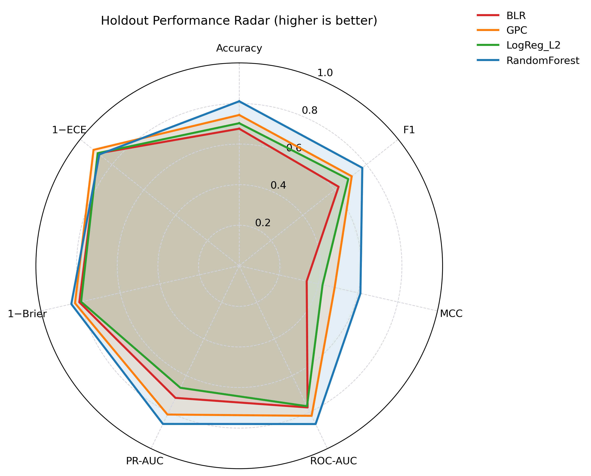
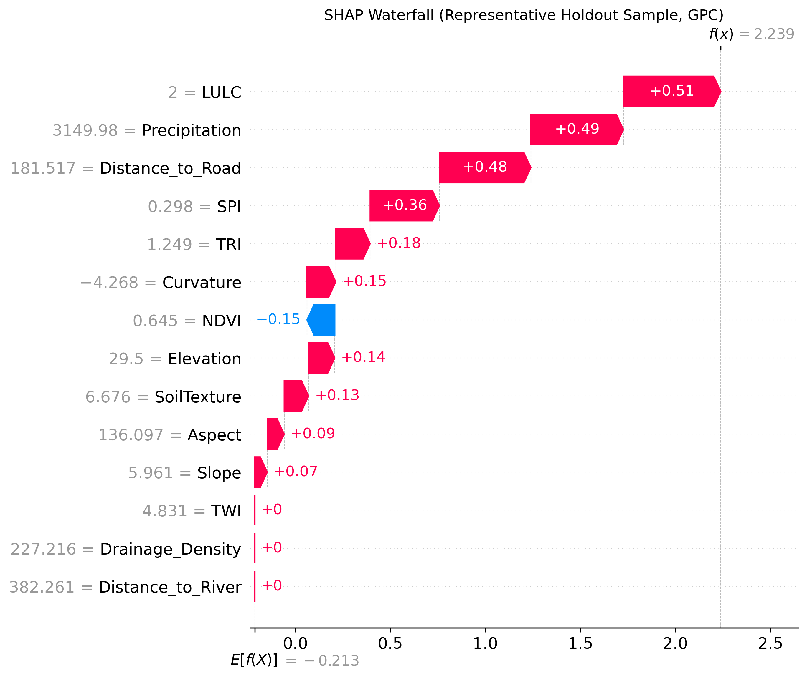

# Probabilistic and Bayesian Machine Learning for Landslide Susceptibility Mapping in Chittagong Metropolitan Area, Bangladesh: Bayesian Deployment with Benchmark Comparison

**Golam Murad**  
*(Replace with full author list + affiliations as required by the Springer Landslides template.)*

## Abstract

Landslide susceptibility mapping (LSM) increasingly relies on machine learning to integrate multi-source conditioning factors and to support planning decisions in landslide-prone terrain. However, high discrimination does not automatically imply decision-ready products when uncertainty communication is a core requirement. This paper presents an uncertainty-aware LSM workflow that **benchmarks deterministic and Bayesian models under an identical validation protocol**, while enforcing a **Bayesian-only deployment policy** for the final susceptibility and uncertainty maps. Using 369 labeled samples (155 landslide; 214 non-landslide) and 14 conditioning factors in the Chittagong Metropolitan Area, Bangladesh, four models were compared: Bayesian Logistic Regression (BLR), Gaussian Process Classifier (GPC), L2-regularized Logistic Regression (LogReg\_L2), and RandomForest. On the independent holdout test, RandomForest achieved the strongest discrimination (MCC = 0.611; ROC-AUC = 0.866), while GPC was the best Bayesian candidate (MCC = 0.481; ROC-AUC = 0.821) with the best calibration among Bayesian candidates (ECE = 0.084). A weighted selection score combining repeated cross-validation, holdout testing, spatial block cross-validation, and calibration ranked RandomForest first overall; nevertheless, final map deployment remained GPC by design to preserve posterior uncertainty representation. Friedman testing of repeated-CV F1 scores confirmed significant differences (statistic = 17.7273; p = 0.0005006466). The deployed GPC-based LSM produced a Very High susceptibility class covering 9.47% of the mapped area while containing 78.71% of observed landslides (SCAI = 0.120), indicating strong concentration of mapped landslides into a limited high-susceptibility footprint.

**Keywords:** landslide susceptibility mapping; Bayesian machine learning; Gaussian process classifier; uncertainty mapping; calibration; spatial cross-validation; model benchmarking

## 1. Introduction

Landslides are among the most damaging geomorphic hazards in mountainous and hilly regions and pose persistent risks to infrastructure, settlements, and ecosystem services. LSM is widely used as a decision-support layer to identify areas with higher likelihood of landslide occurrence by combining landslide inventory data with conditioning factors derived from topography, hydrology, land cover, climate proxies, and anthropogenic influences.

In Bangladesh and comparable environments, recent research demonstrates the breadth of data-driven LSM approaches, ranging from classical machine learning models (e.g., logistic regression and random forests) to hybrid and deep learning frameworks. For example, Chowdhury *et al.* applied logistic regression, random forest, and decision/regression tree models for susceptibility mapping in Chattogram District and reported strong performance of tree-based learners for regional-scale mapping applications [1]. More recent work in the Chittagong Hill Tracts investigated ensemble deep learning strategies to jointly develop susceptibility mapping and a road vulnerability index, emphasizing the role of advanced learners in infrastructure risk studies [2]. Beyond humid tropical settings, hybrid and integrated machine learning approaches have been used to fuse geospatial data for susceptibility assessment in semi-arid environments, demonstrating the portability of modern LSM pipelines across contrasting geomorphic contexts [3].

Despite strong predictive performance in many studies, the **interpretability and uncertainty communication** of susceptibility products remain critical for operational use. A susceptibility map used for prioritization, screening, or infrastructure planning should ideally be accompanied by an uncertainty layer that highlights where predictions are more or less reliable. In this context, Bayesian methods are attractive because they provide a coherent framework for probabilistic prediction and uncertainty representation.

### 1.1 Aim and contribution

This paper contributes a transparent, uncertainty-aware workflow that separates **benchmarking** from **deployment**:

- All models (deterministic and Bayesian) are evaluated under the **same preprocessing and validation protocol**.
- Final map production is **restricted to Bayesian candidates** to maintain posterior-consistent uncertainty representation, even if a deterministic benchmark ranks higher on discrimination metrics.
- Outputs are exported as reproducible artifacts (CSV metrics, PNG figures, and GeoTIFF rasters) to reduce reporting drift and support auditing.

## 2. Study Area and Data

### 2.1 Study area

The study area is the **Chittagong Metropolitan Area (Bangladesh)**, approximately bounded by longitude **91.7589–91.8425** and latitude **22.3269–22.4907** (WGS84).

### 2.2 Landslide inventory and conditioning factors

The modeling dataset (`results/data/LSM_Data.csv`) contains **369** labeled samples:

- Non-landslide (0): **214**
- Landslide (1): **155**

Fourteen conditioning factors were used:

Elevation, Slope, Aspect, Curvature, SPI, TWI, TRI, LULC, NDVI, Precipitation, Drainage\_Density, Distance\_to\_River, Distance\_to\_Road, SoilTexture.

A stratified 80/20 split was used for independent holdout evaluation:

- Train: **295** (171 non-landslide; 124 landslide)
- Test: **74** (43 non-landslide; 31 landslide)

### 2.3 Preprocessing and multicollinearity screening

To improve numerical stability and comparability across models, the same preprocessing pipeline was applied to all learners:

- median imputation for missing values
- standard scaling

Before training, multicollinearity was assessed using variance inflation factor (VIF) and tolerance (TOL) computed on the training split. All predictors remained within acceptable limits (VIF < 5; TOL > 0.20); therefore all 14 factors were retained.

## 3. Methodology

### 3.1 Overview of the workflow

The end-to-end workflow (Fig. 4) includes: preprocessing, repeated stratified cross-validation, independent holdout testing, spatial block cross-validation, statistical model comparison (Friedman + Nemenyi), weighted ranking, Bayesian-restricted deployment, and spatial map generation (susceptibility and uncertainty).

### 3.2 Candidate models and deployment policy

Models were divided into two roles:

- **Bayesian deployment candidates:** BLR and GPC  
- **Benchmark performance models:** LogReg\_L2 and RandomForest

All four models were benchmarked; however, the final susceptibility and uncertainty maps were generated only from the **best Bayesian candidate** according to the weighted selection criteria (Section 3.6).

### 3.3 Validation design

Three complementary validation settings were used:

1. **Repeated stratified cross-validation:** 5 folds × 3 repeats, for robust average performance estimates.
2. **Independent holdout test:** a stratified 20% split, reported as the primary generalization estimate.
3. **Spatial block cross-validation:** GroupKFold using KMeans-derived spatial blocks to approximate spatial independence and reduce overly optimistic estimates from spatial autocorrelation.

### 3.4 Evaluation metrics

The workflow reports standard discrimination and error metrics:

- Accuracy, Precision, Recall, F1-score  
- Matthews correlation coefficient (MCC)  
- ROC-AUC and PR-AUC  
- Brier score and LogLoss (proper scoring rules for probabilistic predictions)  
- Expected calibration error (ECE) for calibration assessment

### 3.5 Statistical comparison

To test whether observed performance differences are statistically meaningful, the Friedman test was applied to repeated-CV F1 scores. When significant, Nemenyi post-hoc testing was used for pairwise comparisons (`results/data/friedman_test.txt`, `results/data/nemenyi_test_results_20260224_012009.csv`).

### 3.6 Weighted selection rule (benchmark + calibration + spatial generalization)

Model selection used a weighted rank-based score (`results/data/model_selection_table.csv`):

- 20% CV MCC rank  
- 35% holdout MCC rank  
- 30% spatial MCC rank  
- 10% holdout Brier rank (lower is better)  
- 5% holdout ECE rank (lower is better)

Although the score ranks all models, deployment is restricted to Bayesian candidates (BLR/GPC) to ensure uncertainty-consistent map products.

### 3.7 Susceptibility and uncertainty mapping

For the deployed Bayesian model, point-level susceptibility probabilities were computed and interpolated onto a 500×500 grid over the study area using linear interpolation. The susceptibility surface was classified into five tiers (Very Low, Low, Moderate, High, Very High) using Jenks natural breaks computed from the predicted probabilities. For uncertainty:

- BLR uses posterior predictive variability (probability standard deviation via posterior sampling).
- GPC uses latent function variance (via `latent_mean_and_variance`) as an uncertainty proxy.

When model-based uncertainty is not available, the pipeline defaults to a decision-boundary uncertainty proxy (maximal near probability 0.5).

### 3.8 Susceptibility class concentration (SCAI)

To evaluate whether high-susceptibility classes capture landslides while occupying limited area, the Seed Cell Area Index (SCAI) was computed for each susceptibility tier (`results/data/SCAI_Analysis.csv`). Lower SCAI values in higher tiers indicate better concentration of landslides into smaller mapped areas.

## 4. Results

### 4.1 Holdout performance and multi-metric comparison

Table 1 summarizes the independent holdout performance. RandomForest was the strongest benchmark model, while GPC was the best Bayesian candidate and was therefore deployed for final mapping.

**Table 1. Holdout test performance (20% split).**

| Model | Role | Accuracy | Precision | Recall | F1 | MCC | ROC-AUC | PR-AUC | Brier | ECE |
| --- | --- | ---: | ---: | ---: | ---: | ---: | ---: | ---: | ---: | ---: |
| RandomForest | Benchmark | 0.811 | 0.774 | 0.774 | 0.774 | 0.611 | 0.866 | 0.865 | 0.153 | 0.120 |
| GPC | Bayesian candidate | 0.743 | 0.676 | 0.742 | 0.708 | 0.481 | 0.821 | 0.814 | 0.172 | 0.084 |
| LogReg\_L2 | Benchmark | 0.703 | 0.615 | 0.774 | 0.686 | 0.420 | 0.768 | 0.667 | 0.203 | 0.110 |
| BLR | Bayesian candidate | 0.676 | 0.606 | 0.645 | 0.625 | 0.340 | 0.775 | 0.723 | 0.193 | 0.112 |

To visualize performance across multiple metrics simultaneously (including calibration), a radar plot is provided in Fig. 5 (calibration metrics are inverted as 1−Brier and 1−ECE so higher values indicate better performance).

### 4.2 Cross-validation and spatial generalization

Table 2 summarizes repeated-CV and spatial block CV outcomes. As expected, spatial block CV yields lower MCC values than repeated stratified CV, reflecting the increased difficulty of spatial generalization.

**Table 2. Repeated CV and spatial block CV summary.**

| Model | Role | CV MCC (mean) | CV ROC-AUC (mean) | Spatial MCC (mean) | Spatial ROC-AUC (mean) |
| --- | --- | ---: | ---: | ---: | ---: |
| RandomForest | Benchmark | 0.498 | 0.849 | 0.323 | 0.805 |
| GPC | Bayesian candidate | 0.450 | 0.836 | 0.259 | 0.769 |
| LogReg\_L2 | Benchmark | 0.433 | 0.756 | 0.214 | 0.709 |
| BLR | Bayesian candidate | 0.388 | 0.757 | 0.226 | 0.709 |

### 4.3 Statistical significance and model ranking

The Friedman test on repeated-CV F1 scores indicated statistically significant differences among models:

- Friedman statistic = **17.7273**
- p-value = **0.0005006466**

Weighted ranking across all models produced:

1. RandomForest (selection score = 1.15)  
2. GPC (selection score = 1.95)  
3. LogReg\_L2 (selection score = 3.35)  
4. BLR (selection score = 3.55)

Although RandomForest is the overall benchmark leader, the deployment policy restricts final mapping to Bayesian candidates; thus **GPC is selected for deployment** (`Deployment_Selected = True` in `results/data/model_selection_table.csv`).

### 4.4 Explainability (global and local)

Global SHAP analysis for the deployed model highlights **Elevation**, **Precipitation**, and **LULC** as dominant contributors in the study area (Fig. 9). To complement global importance with a local interpretation, a SHAP waterfall plot is provided for a representative holdout sample predicted as high susceptibility by GPC (Fig. 10).

### 4.5 Final susceptibility and uncertainty products (Bayesian deployment)

Final susceptibility and uncertainty maps were produced only from the deployed Bayesian model (GPC):

SCAI outcomes are summarized in Table 3. The Very High class contains the majority of mapped landslides while occupying a relatively small area fraction, indicating strong concentration of landslide locations into the high-susceptibility tier.

**Table 3. SCAI by susceptibility tier (deployed GPC map).**

| Tier | Area % | Landslide % | Landslide Count | SCAI |
| --- | ---: | ---: | ---: | ---: |
| Very Low | 29.37 | 0.65 | 1 | 45.53 |
| Low | 23.16 | 0.65 | 1 | 35.90 |
| Moderate | 24.04 | 5.81 | 9 | 4.14 |
| High | 13.96 | 14.19 | 22 | 0.98 |
| Very High | 9.47 | 78.71 | 122 | 0.12 |

## 5. Discussion

### 5.1 Benchmarking outcomes in the context of recent LSM studies

The results reinforce a common pattern in LSM research: ensemble tree models often provide strong discrimination on tabular conditioning factors. This agrees with regional evidence from Chattogram District where random forest performance was competitive for susceptibility mapping tasks under comparable factor sets [1]. At the same time, modern deep learning ensembles are increasingly used to integrate complex conditioning information and to support infrastructure vulnerability analyses [2]. Hybrid modeling strategies and geospatial-data integration have also been explored in semi-arid environments to improve robustness under distinct climatic and geomorphic conditions [3].

In this study, RandomForest ranked first overall under the weighted selection score. However, map deployment was intentionally constrained to Bayesian candidates because the objective of this research is not only classification performance but also **uncertainty-aware interpretation**. The deployed GPC provides a probabilistic susceptibility surface along with a model-based uncertainty proxy derived from latent variance, which is valuable for communicating where the model is confident versus uncertain.

### 5.2 Practical implications for uncertainty-aware planning

For operational use, uncertainty information can support:

- prioritizing field verification in high-uncertainty regions
- cautionary interpretation of sharp susceptibility gradients where uncertainty is high
- resource allocation decisions that weigh risk and confidence jointly

### 5.3 Limitations and future work

Key limitations include:

- A moderate sample size (369 points) limits the complexity of models that can be reliably trained without overfitting.
- Spatial interpolation of point probabilities to a regular grid may not capture fine-scale geomorphic controls and should be improved with higher-resolution covariates and fully spatial modeling when available.
- The uncertainty layer is a practical proxy (latent variance / posterior variability) rather than a full end-to-end Bayesian geostatistical model.

Future work may include expanding the landslide inventory, incorporating additional spatial predictors (e.g., lithology, lineament density, rainfall extremes), testing deep Bayesian models, and evaluating transferability across adjacent regions.

## 6. Conclusion

This research developed and demonstrated a reproducible LSM workflow that:

- benchmarks deterministic and Bayesian models under identical validation settings;
- applies repeated CV, independent holdout testing, and spatial block CV with full metric reporting;
- uses Friedman + Nemenyi testing to assess statistically significant differences;
- enforces Bayesian-only deployment for final susceptibility and uncertainty maps to align with uncertainty-aware objectives.

On this dataset, RandomForest is the strongest benchmark performer, while **GPC** is the selected Bayesian deployment model. The deployed GPC-based LSM concentrates most observed landslides within a small Very High susceptibility footprint (Area = 9.47%; Landslide = 78.71%; SCAI = 0.12), and provides an accompanying uncertainty surface to support cautious interpretation.

## Declarations (Springer-style placeholders)

**Funding:** (State funding source or “No external funding was received.”)  
**Conflicts of interest:** The author(s) declare no competing interests.  
**Ethical approval:** Not applicable.  
**Consent to participate:** Not applicable.  
**Consent for publication:** Not applicable.  
**Data and code availability:** All data and generated outputs used in this manuscript are provided in this repository (e.g., `results/data/LSM_Data.csv`, `results/data/*.csv`, `results/figures/*.png`, `results/data/*.tif`).

## References (IEEE style)

[1] M. S. Chowdhury, M. N. Rahman, M. S. Sheikh, M. A. Sayeid, K. H. Mahmud, and B. Hafsa, “GIS-based landslide susceptibility mapping using logistic regression, random forest and decision and regression tree models in Chattogram District, Bangladesh,” *Heliyon*, vol. 10, e23424, 2024, doi: 10.1016/j.heliyon.2023.e23424.  
[2] N. Biswas, K. S. Islam, E. A. Efty, S. Das, A. M. Pathan, and M. R. Ferdaus, “Ensemble deep learning framework for landslide susceptibility mapping and road vulnerability index development in the Chittagong Hill Tracts, Bangladesh,” *Geomatics, Natural Hazards and Risk*, vol. 17, no. 1, Art. no. 2634207, 2026, doi: 10.1080/19475705.2026.2634207.  
[3] H. Ait Naceur, B. Igmoullan, M. Namous, Y. Lassiane, H. Benazun, J. Mallick, H. T. Hang, and H. G. Abdo, “Integrating geospatial data and hybrid machine learning models for landslide susceptibility assessment in semi-arid environments,” *Geomatics, Natural Hazards and Risk*, vol. 17, no. 1, Art. no. 2625403, 2026, doi: 10.1080/19475705.2026.2625403.
