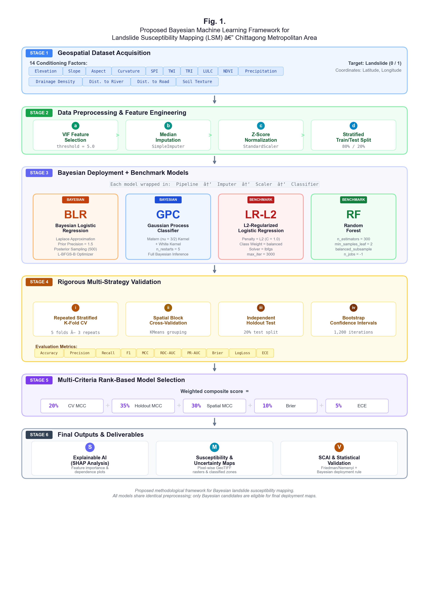
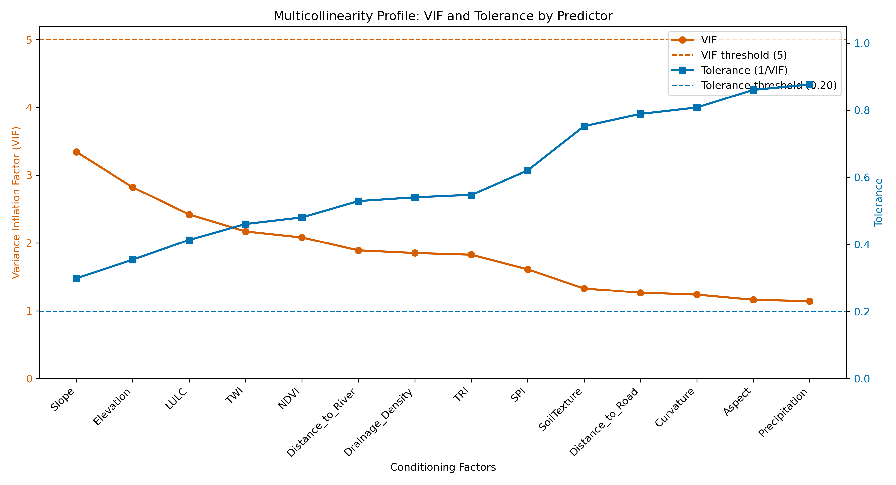
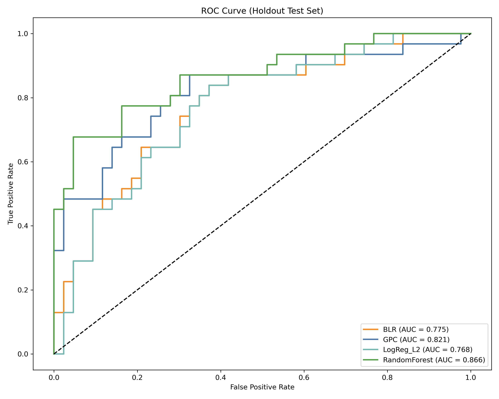
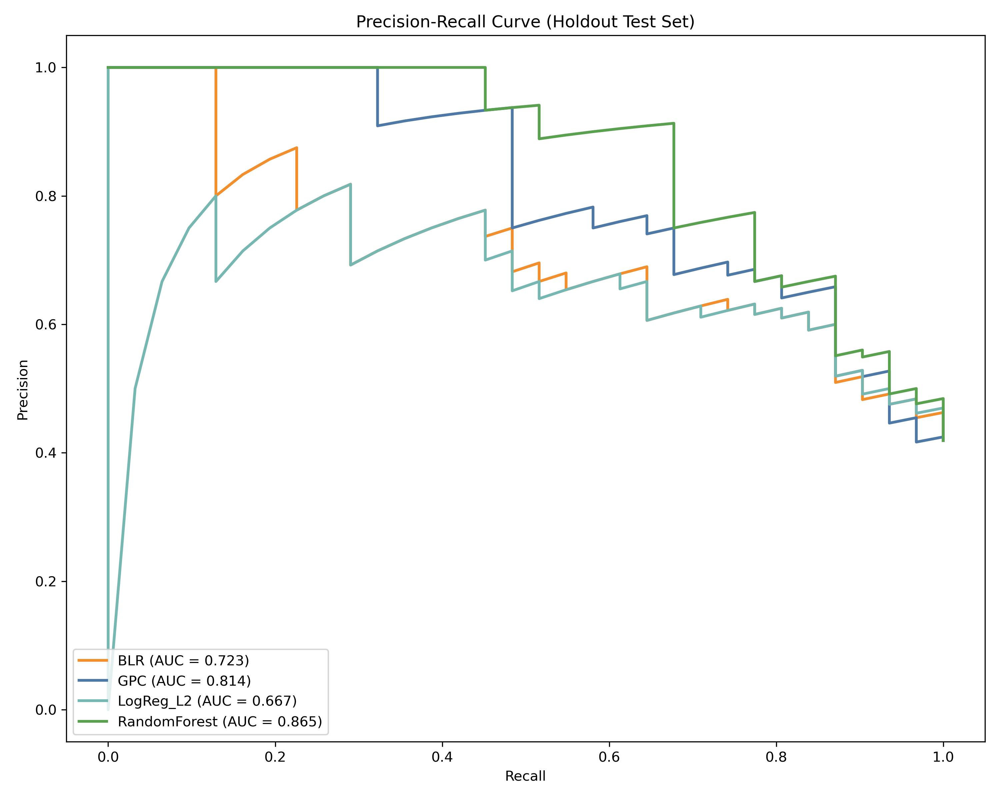
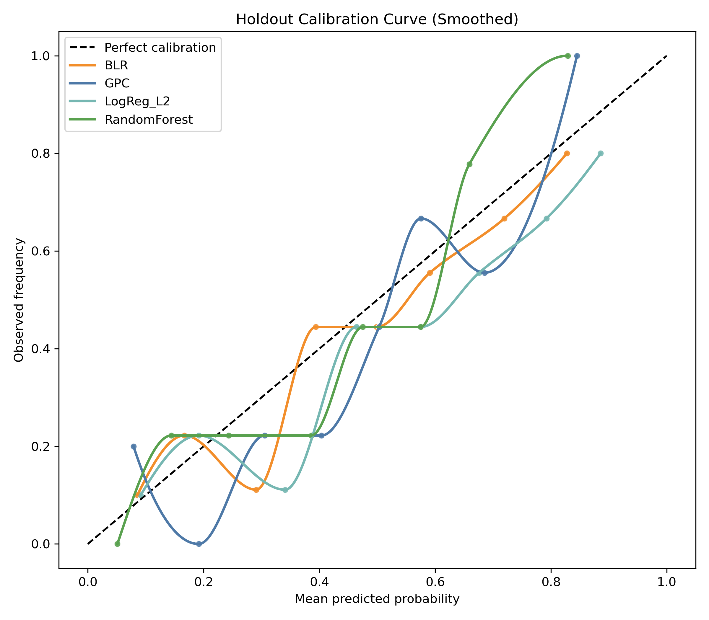
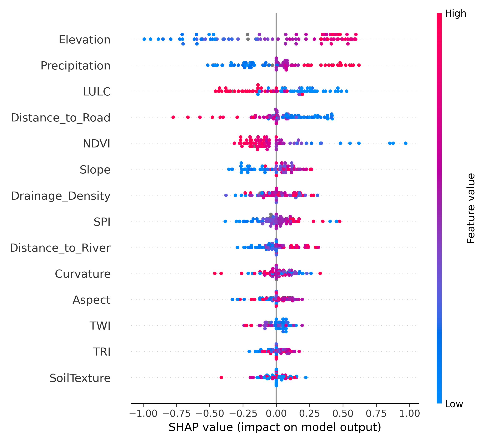
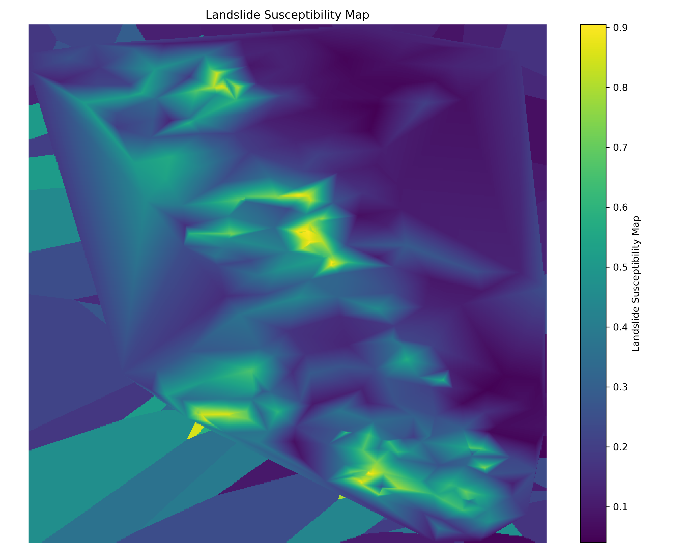
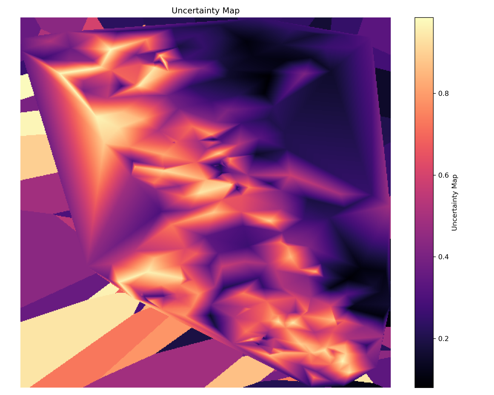

# Probabilistic and Bayesian Machine Learning for Landslide Susceptibility Mapping in Chittagong Metropolitan Area, Bangladesh: Demo Manuscript (Bayesian Deployment with Benchmark Comparison)

**[Golam Murad]**

## Abstract

This study presents an uncertainty-aware landslide susceptibility workflow that benchmarks deterministic and Bayesian models under identical validation while constraining final deployment to Bayesian candidates. Using 369 labeled samples and 14 conditioning factors, four models were assessed: Bayesian Logistic Regression (BLR), Gaussian Process Classifier (GPC), L2-regularized Logistic Regression (LogReg_L2), and RandomForest. The benchmark leader was RandomForest (holdout MCC = 0.611; ROC-AUC = 0.866), while GPC was the best Bayesian model (holdout MCC = 0.481; ROC-AUC = 0.821; ECE = 0.084). Weighted ranking over repeated CV, holdout, spatial CV, and calibration placed RandomForest first overall, but final deployment remained GPC by design because susceptibility and uncertainty products require Bayesian posterior uncertainty representation and uncertainty-consistent interpretation. Friedman test on CV F1 scores indicated significant model differences (statistic = 17.7273, p = 0.0005006466), with Nemenyi post-hoc analysis saved in repository outputs. Final GPC-based mapping yielded a Very High class covering 9.47% of area and containing 78.71% of mapped landslides (SCAI = 0.120).

**Keywords:** landslide susceptibility, Bayesian machine learning, uncertainty mapping, Gaussian process classifier, benchmark comparison, calibration, spatial cross-validation

## 1. Introduction

Landslide susceptibility mapping for planning applications benefits from both strong discrimination and explicit uncertainty quantification. Deterministic models may achieve high predictive scores, but Bayesian models are often preferred when posterior uncertainty representation is a core objective.

Accordingly, this workflow distinguishes:

- **Benchmark performance models:** `LogReg_L2`, `RandomForest`
- **Bayesian deployment candidates:** `BLR`, `GPC`

All models are benchmarked under identical conditions, but final map generation is restricted to the best Bayesian candidate.

## 2. Materials and Methods

### 2.1 Study Area

The study area is the Chittagong Metropolitan Area (Bangladesh), approximately bounded by longitude 91.7589-91.8425 and latitude 22.3269-22.4907 (WGS84).

### 2.2 Dataset and Predictors

The dataset (`results/data/LSM_Data.csv`) contains 369 samples:

- Non-landslide (0): 214
- Landslide (1): 155

Predictors (14): Elevation, Slope, Aspect, Curvature, SPI, TWI, TRI, LULC, NDVI, Precipitation, Drainage_Density, Distance_to_River, Distance_to_Road, SoilTexture.

Train/test split (stratified 80/20):

- Train: 295 (171 non-landslide, 124 landslide)
- Test: 74 (43 non-landslide, 31 landslide)

### 2.3 Methodological Framework Figure

The complete end-to-end workflow used in this study is illustrated below, including preprocessing, model benchmarking, Bayesian-restricted deployment selection, and final map generation.

### 2.4 Multicollinearity Screening (VIF and Tolerance)

To verify predictor stability before modeling, variance inflation factor (VIF) and tolerance profiles were computed on the training split.

All predictors remained within acceptable multicollinearity limits (VIF < 5; TOL > 0.20), so all 14 factors were retained.

### 2.5 Pipeline and Validation

Shared preprocessing for all models:

- median imputation
- standard scaling
- classifier

Validation protocol:

1. repeated stratified CV (5 folds x 3 repeats)
2. independent holdout test (20%)
3. spatial block CV (KMeans groups + GroupKFold)

Metrics: Accuracy, Precision, Recall, F1, MCC, ROC-AUC, PR-AUC, Brier, LogLoss, ECE.

### 2.6 Candidate Models and Roles

Deployment candidates (Bayesian):

1. BLR: Laplace-approximate Bayesian logistic regression
2. GPC: Gaussian process classifier (Matern + White kernel)

Benchmark-only models:

3. LogReg_L2: L2-regularized logistic regression
4. RandomForest: tree-ensemble classifier

### 2.7 Statistical Testing and Selection Rule

Model-comparison significance was evaluated with Friedman test on CV F1, followed by Nemenyi post-hoc when significant (`results/data/friedman_test.txt`, `results/data/nemenyi_test_results_20260224_012009.csv`).

Weighted selection criteria (`results/data/model_selection_table.csv`):

- 20% CV MCC rank
- 35% holdout MCC rank
- 30% spatial MCC rank
- 10% holdout Brier rank (lower better)
- 5% holdout ECE rank (lower better)

Final deployment is restricted to Bayesian candidates only.

## 3. Results

### 3.1 Holdout Performance

| Model | Role | Accuracy | Precision | Recall | F1 | MCC | ROC-AUC | PR-AUC | Brier | ECE |
| --- | --- | ---: | ---: | ---: | ---: | ---: | ---: | ---: | ---: | ---: |
| RandomForest | Benchmark | 0.811 | 0.774 | 0.774 | 0.774 | 0.611 | 0.866 | 0.865 | 0.153 | 0.120 |
| GPC | Bayesian candidate | 0.743 | 0.676 | 0.742 | 0.708 | 0.481 | 0.821 | 0.814 | 0.172 | 0.084 |
| LogReg_L2 | Benchmark | 0.703 | 0.615 | 0.774 | 0.686 | 0.420 | 0.768 | 0.667 | 0.203 | 0.110 |
| BLR | Bayesian candidate | 0.676 | 0.606 | 0.645 | 0.625 | 0.340 | 0.775 | 0.723 | 0.193 | 0.112 |

### 3.2 CV and Spatial Generalization

| Model | Role | CV MCC | CV ROC-AUC | Spatial MCC | Spatial ROC-AUC |
| --- | --- | ---: | ---: | ---: | ---: |
| RandomForest | Benchmark | 0.498 | 0.849 | 0.323 | 0.805 |
| GPC | Bayesian candidate | 0.450 | 0.836 | 0.259 | 0.769 |
| LogReg_L2 | Benchmark | 0.433 | 0.756 | 0.214 | 0.709 |
| BLR | Bayesian candidate | 0.388 | 0.757 | 0.226 | 0.709 |

### 3.3 Statistical Significance and Ranking

- Friedman test on CV F1: statistic = 17.7273, p = 0.0005006466.
- Ranking across all models:
  1. RandomForest (selection score 1.15)
  2. GPC (selection score 1.95)
  3. LogReg_L2 (selection score 3.35)
  4. BLR (selection score 3.55)

Although RandomForest is the overall benchmark leader, `Deployment_Eligible` and `Deployment_Selected` fields in `results/data/model_selection_table.csv` enforce Bayesian-only deployment; therefore GPC is selected for final mapping.

### 3.4 Explainability

SHAP from the final deployment model (GPC) identifies Elevation, Precipitation, and LULC as dominant contributors.

### 3.5 Final Bayesian Maps and SCAI

Final susceptibility and uncertainty maps are generated only from GPC:

SCAI outcomes:

| Tier | Area % | Landslide % | Landslide Count | SCAI |
| --- | ---: | ---: | ---: | ---: |
| Very Low | 29.37 | 0.65 | 1 | 45.53 |
| Low | 23.16 | 0.65 | 1 | 35.90 |
| Moderate | 24.04 | 5.81 | 9 | 4.14 |
| High | 13.96 | 14.19 | 22 | 0.98 |
| Very High | 9.47 | 78.71 | 122 | 0.12 |

## 4. Discussion

The benchmark results confirm that deterministic models can produce stronger discrimination on this dataset, with RandomForest ranking first overall. However, deployment in this research is intentionally Bayesian: maps are decision products requiring interpretable probability surfaces with coherent uncertainty representation tied to model posterior behavior. GPC provides better calibration among Bayesian candidates (ECE = 0.084) and supplies posterior uncertainty needed for uncertainty-aware hazard communication.

This separation between benchmarking and deployment improves methodological transparency: deterministic models are retained for robustness assessment, while final susceptibility and uncertainty maps remain aligned with the uncertainty-focused Bayesian objective.

## 5. Conclusion

The updated workflow now:

- benchmarks `BLR`, `GPC`, `LogReg_L2`, and `RandomForest` under identical preprocessing and validation;
- reports full metric and statistical comparisons for all models;
- deploys only the best Bayesian candidate for final susceptibility and uncertainty maps.

For this run, RandomForest is best overall benchmark model, while **GPC** is the final Bayesian deployment model used for map generation.
